# `_template`: copy me

> Replace this title by `<pipeline id>: <one-line idea>`. Keep the 11 numbered sections below;
> `tests/test_pipelines.py` checks that they exist. Delete the quoted guidance as you fill
> each section.

| | |
|---|---|
| **Task** | detection / classification |
| **Status** | planned / in progress / done (see "done" in AGENTS.md) |
| **Parent** | `<parent pipeline id>` or none |
| **Setting(s)** | `zero_shot` / `few_shot` (decision D4) |

## 1. Summary

> Three lines: the idea; the hypothesis it tests; the parent pipeline and the single building
> block this one adds.

## 2. Diagram

> Edit `diagram.mmd` (stages, models, data flows), then run
> `uv run python scripts/render_diagrams.py`. Never edit `diagram.svg` by hand.

## 3. Models

| Role | Model | Exact checkpoint | Licence | Precision / quantisation | GPU memory | Serving |
|---|---|---|---|---|---|---|
| > e.g. grounder | | > HF id + revision, from `configs/models/<name>.yaml` | | | | > vLLM / in-process |

## 4. Prompts

| File | Role | Variables | Expected output |
|---|---|---|---|
| `prompts/propose.jinja` | > what the prompt asks | `class_names` | > JSON schema of the answer |

## 5. Step-by-step walkthrough

> For `prepare()` and for each stage of `annotate()`: inputs, outputs and their formats
> (e.g. "candidates: list[Detection], absolute xyxy pixels, score in [0, 1]").

## 6. Rationale

> Why this should work, with links to the notes in [papers/README.md](../../papers/README.md)
> (e.g. `[SAM 3](../../papers/README.md#sam3)`).

## 7. Failure structure

| Stage | Failure mode | How it is detected | What the pipeline does | Rate in last run |
|---|---|---|---|---|
| > propose | > parse error | > JSON / schema validation | > retry once, then empty output | > from `failures.jsonl` |

## 8. Cost

> Mean, p95 and max time per image; model calls and tokens per image; cost of `prepare`;
> GPU resources. Taken from `timings.json` of the last dev run.

## 9. Results

<!-- BEGIN results (generated by scripts/make_leaderboard.py, do not edit) -->
_No run yet._
<!-- END results -->

## 10. Known limitations and next steps

> What is known not to work, and the ideas it suggests (often the next pipeline).

## 11. Changelog

> One dated line per change of behaviour (prompt, threshold, stage), with the run it affects.
