# `c00_siglip2_zeroshot`: SigLIP 2 zero-shot classification

| | |
|---|---|
| **Task** | classification (task 1: one class or "none" per image) |
| **Status** | runs (see Results) |
| **Parent** | none |
| **Setting(s)** | `described` (names and descriptions, D17); also `zero_shot` (names only) |

## 1. Summary

- **Idea.** Score every known class with SigLIP 2, using the class name and each line of its
  description as texts; take the best class, or "none" if its probability is low.
- **Hypothesis.** A strong contrastive model with description ensembling is a solid floor,
  but it has no reliable "none" (Miller et al.).
- **Parent.** None: the contrastive baseline of task 1.

## 2. Diagram

## 3. Models

| Role | Model | Exact checkpoint | Licence | Precision / quantisation | GPU memory | Serving |
|---|---|---|---|---|---|---|
| Scorer | SigLIP 2 So400m/14 @ 384 (`configs/models/siglip2_so400m.yaml`) | `google/siglip2-so400m-patch14-384` @ `e8e48729` | Apache 2.0 | fp32 | about 5 GB | HTTP server in the vLLM container (`serving/launch_siglip.sh`) |

## 4. Prompts

| File | Role | Variables | Expected output |
|---|---|---|---|
| `prompts/siglip_texts.jinja` | One text per line: "a photo of a {class}." and "a photo of a {class}: {description line}" | `class_name`, `description_lines` | none: logits averaged per class |

## 5. Step-by-step walkthrough

- **`prepare()`.** Renders the texts of every known class (up to `description_lines` lines).
- **Stage `score`.** One image embedding; each class gets the mean SigLIP logit
  (`logit_scale * cos + logit_bias`) of its texts, then its sigmoid probability.
- **Decision.** The top class, or "none" if the dataset allows it and the top probability is
  below `none_threshold`. `class_scores` holds every class's probability.

## 6. Rationale

SigLIP 2 is among the strongest open contrastive models for zero-shot classification. Prompt
ensembling with class descriptions follows CLIP, CuPL and ELEVATER's knowledge-augmented
evaluation (see `c01` for references).

## 7. Failure structure

| Stage | Failure mode | How it is detected | What the pipeline does | Rate in last run |
|---|---|---|---|---|
| score | server error or timeout | `ModelError` / `TimeoutError` | no label (counted as "none") | see `metrics.json` |
| score | confident open-set error | evaluation (AuPR, P@95R) | none: the reason for `c01` | see Results |

## 8. Cost

One image embedding per image; the class texts are embedded once per dataset.

## 9. Results

<!-- BEGIN results (generated by scripts/make_leaderboard.py, do not edit) -->
**Classification, setting `described`, subset `dev`** (in %)

| Pipeline | Dataset | Domain | Images | Accuracy | Closed acc. | Macro-F1 | None F1 | AuPR | s/img mean | s/img p95 | calls/img | failures | Run |
|---|---|---|---:|---:|---:|---:|---:|---:|---:|---:|---:|---:|---|
| `c00_siglip2_zeroshot` | eurosat | Remote sensing | 200 | 35.0 | 54.4 | 25.7 | 38.8 | 90.7 | 0.83 | 1.23 | 1.0 | 0.0% | `2026-10-28_c00_siglip2_zeroshot_elevater_dev_described_dev_c041d26e` |
| `c00_siglip2_zeroshot` | dtd | Textures | 200 | 49.5 | 66.7 | 47.9 | 43.1 | 85.6 | 2.14 | 9.48 | 1.0 | 0.0% | `2026-10-28_c00_siglip2_zeroshot_elevater_dev_described_dev_c041d26e` |
| `c00_siglip2_zeroshot` | gtsrb | Traffic signs | 200 | 51.0 | 68.1 | 50.0 | 12.9 | 87.4 | 1.70 | 6.66 | 1.0 | 0.0% | `2026-10-28_c00_siglip2_zeroshot_elevater_dev_described_dev_c041d26e` |
| `c00_siglip2_zeroshot` | fer2013 | Faces | 200 | 16.0 | 36.8 | 16.8 | 8.2 | 67.4 | 0.94 | 1.97 | 1.0 | 0.0% | `2026-10-28_c00_siglip2_zeroshot_elevater_dev_described_dev_c041d26e` |
| `c00_siglip2_zeroshot` | fgvc_aircraft | Fine-grained objects | 200 | 17.5 | 19.6 | 13.0 | 18.2 | 67.5 | 3.26 | 15.49 | 1.0 | 0.0% | `2026-10-28_c00_siglip2_zeroshot_elevater_dev_described_dev_c041d26e` |
| `c00_siglip2_zeroshot` | **mean of 5** | | | **33.8** | 49.1 | 30.7 | 24.2 | 79.7 | | | | | |
<!-- END results -->

## 10. Known limitations and next steps

- `none_threshold` (0.01) is a placeholder, to tune on dev.
- Generic template only: ELEVATER's per-dataset templates would be per-dataset tuning.

## 11. Changelog

- 2026-10-28: first version.
