# `c01_rar_siglip2_qwen3vl`: retrieve with SigLIP 2, rank with Qwen3-VL

| | |
|---|---|
| **Task** | classification (task 1: one class or "none" per image) |
| **Status** | runs (see Results) |
| **Parent** | `c00_siglip2_zeroshot` |
| **Setting(s)** | `described` (class names and descriptions, D17) |

## 1. Summary

- **Idea.** A contrastive model shortlists the k most likely classes; an MLLM sees the image
  and the k candidates with their descriptions, plus a "none of these" option, and picks one.
- **Hypothesis.** Contrastive models rank many classes well but confuse fine-grained ones,
  and they have no notion of "none". An MLLM reasons better over a few described candidates
  and can reject them all.
- **Parent.** `c00`, whose SigLIP 2 scores give the shortlist; c01 adds the ranking stage.

## 2. Diagram

## 3. Models

| Role | Model | Exact checkpoint | Licence | Precision / quantisation | GPU memory | Serving |
|---|---|---|---|---|---|---|
| Retriever | SigLIP 2 So400m/14 @ 384 (`configs/models/siglip2_so400m.yaml`) | `google/siglip2-so400m-patch14-384` @ `e8e48729` | Apache 2.0 | fp32 | about 5 GB | HTTP server in the vLLM container (`serving/launch_siglip.sh`) |
| Ranker | Qwen3-VL-30B-A3B-Instruct (`configs/models/qwen3_vl_30b.yaml`) | `Qwen/Qwen3-VL-30B-A3B-Instruct` @ `9c4b90e1` | Apache 2.0 | bf16 | about 62 GB | vLLM |

Both fit on one B200 (SigLIP shares the vLLM GPU).

## 4. Prompts

| File | Role | Variables | Expected output |
|---|---|---|---|
| `prompts/siglip_texts.jinja` | Texts scored by SigLIP for one class: "a photo of a {class}." and one text per description line | `class_name`, `description_lines` | none: SigLIP logits, averaged per class |
| `prompts/choose.jinja` | Multiple choice over the candidates (letters A, B...), each with the first `mllm_description_lines` lines of its description, then "None of the above" | `options` (letter, name, description) | one letter; its first-token log-probabilities give the option probabilities |

## 5. Step-by-step walkthrough

- **`prepare()`.** Renders the SigLIP texts of every known class (name + up to
  `description_lines` description lines) and the short descriptions shown to the MLLM.
- **Stage `retrieve`** (`stages.classification.text_scores`). One image embedding and the
  cached text embeddings give each class the mean SigLIP logit of its texts. The `top_k` (5)
  classes become the candidates.
- **Stage `rank`** (`stages.classification.multiple_choice`). One MLLM call with
  `max_tokens=1` and the top-20 log-probabilities of the answer token. Each option's
  probability is the softmax over option letters (variants such as " A" merged). If no letter
  is among the top tokens, the answer text's first letter is used.
- **Decision.** The option with the highest probability wins; "none" if that is the
  "none" option, or if the best class's probability is below `none_threshold` (0 by default:
  the MLLM decides). `class_scores` holds the MLLM probability of each candidate (0 for the
  other classes); the open-set metrics rank images by its maximum.
- **Fallback.** If `rank` fails, the label is c00's decision from the retriever's scores, with
  `extras.fallback = "retriever"`.

## 6. Rationale

- **RAR.** Liu et al., "RAR: Retrieving And Ranking Augmented MLLMs for Visual Recognition"
  (arXiv 2403.13805) retrieve the top-k classes with CLIP and let an MLLM rank them. They
  report gains on fine-grained, few-shot and zero-shot recognition. We keep its structure
  without its fine-tuned ranker and use k = 5, its example.
- **Descriptions.** CuPL and ELEVATER's knowledge-augmented prompts improve contrastive
  zero-shot classification. The ELEVATER descriptions (WordNet, Wiktionary, GPT-3) feed both
  stages.
- **"None".** Miller et al. (ECCV 2024, arXiv 2403.16528) show that contrastive classifiers
  give confident open-set errors. An explicit "none" option lets the MLLM reject instead.
- **Scores.** The scores come from log-probabilities, not from verbal confidence, so that
  they rank images for the AuPR / P@95R metrics.

## 7. Failure structure

| Stage | Failure mode | How it is detected | What the pipeline does | Rate in last run |
|---|---|---|---|---|
| retrieve | SigLIP server error or timeout | `ModelError` / `TimeoutError` | no label (counted as "none") | see `metrics.json` (`failures`) |
| rank | MLLM server error, timeout | same | falls back to the retriever's decision | same |
| rank | no option letter in the answer | `ParseError` | falls back to the retriever's decision | same |
| retrieve | true class not in the top k | evaluation only (`extras.candidates`) | the MLLM can only answer another class or "none" | not measured yet |

## 8. Cost

Per image: one SigLIP image embedding, and one MLLM call with one output token (prompt about
1–2k tokens with the image). The class texts are embedded once per dataset. Measured values are
in `timings.json` of each run.

## 9. Results

<!-- BEGIN results (generated by scripts/make_leaderboard.py, do not edit) -->
**Classification, setting `described`, subset `dev`** (in %)

| Pipeline | Dataset | Domain | Images | Accuracy | Closed acc. | Macro-F1 | None F1 | AuPR | s/img mean | s/img p95 | calls/img | failures | Run |
|---|---|---|---:|---:|---:|---:|---:|---:|---:|---:|---:|---:|---|
| `c01_rar_siglip2_qwen3vl` | eurosat | Remote sensing | 200 | 35.5 | 61.3 | 26.3 | 37.6 | 86.4 | 0.38 | 0.77 | 2.0 | 0.0% | `2026-10-28_c01_rar_siglip2_qwen3vl_elevater_dev_described_dev_b06137a9` |
| `c01_rar_siglip2_qwen3vl` | dtd | Textures | 200 | 58.0 | 74.7 | 60.1 | 23.5 | 79.1 | 0.42 | 0.66 | 2.0 | 0.0% | `2026-10-28_c01_rar_siglip2_qwen3vl_elevater_dev_described_dev_b06137a9` |
| `c01_rar_siglip2_qwen3vl` | gtsrb | Traffic signs | 200 | 41.5 | 74.3 | 24.1 | 46.1 | 84.3 | 0.34 | 0.51 | 2.0 | 0.0% | `2026-10-28_c01_rar_siglip2_qwen3vl_elevater_dev_described_dev_b06137a9` |
| `c01_rar_siglip2_qwen3vl` | fer2013 | Faces | 200 | 50.0 | 66.1 | 36.8 | 38.0 | 96.4 | 0.31 | 0.42 | 2.0 | 0.0% | `2026-10-28_c01_rar_siglip2_qwen3vl_elevater_dev_described_dev_b06137a9` |
| `c01_rar_siglip2_qwen3vl` | fgvc_aircraft | Fine-grained objects | 200 | 28.0 | 27.8 | 13.1 | 38.3 | 81.5 | 1.13 | 1.40 | 2.0 | 0.0% | `2026-10-28_c01_rar_siglip2_qwen3vl_elevater_dev_described_dev_b06137a9` |
| `c01_rar_siglip2_qwen3vl` | **mean of 5** | | | **42.6** | 60.8 | 32.1 | 36.7 | 85.5 | | | | | |
<!-- END results -->

## 10. Known limitations and next steps

- Retrieval errors cannot be fixed by the ranker. Next: measure the top-k recall on dev and
  tune k.
- No exemplar images (`few_shot`): RAR's in-context ranking examples are a next step.
- `none_threshold` and the description length are not tuned yet (dev only).
- Ranking calibration: the letter probabilities can carry position bias. Next: permute the
  candidates and average the probabilities.

## 11. Changelog

- 2026-10-28: first version (SigLIP 2 So400m top 5, Qwen3-VL-30B-A3B letters with logprobs,
  explicit "none" option).
