# `p00_sam3_raw`: SAM 3 prompted with the raw class names

| | |
|---|---|
| **Task** | detection |
| **Status** | runs on the dev subset (2026-10-28); smoke test passes |
| **Parent** | none |
| **Setting(s)** | `zero_shot` (class names only, D4) |

## 1. Summary

- **Idea.** Prompt SAM 3 with each class name as it appears in the dataset, keep its boxes
  and scores.
- **Hypothesis.** None to test: this is the floor every SAM 3 pipeline must beat.
- **Parent.** None; `p02` adds concept-card phrases on top of it.

## 2. Diagram

## 3. Models

| Role | Model | Exact checkpoint | Licence | Precision / quantisation | GPU memory | Serving |
|---|---|---|---|---|---|---|
| Grounder | SAM 3 (`configs/models/sam3.yaml`) | `facebook/sam3` @ `3c879f39` (gated) | SAM License; TODO(verify) full text | fp32 (3.4 GB of weights) | 1 GPU | HTTP server in the vLLM container (`serving/launch_sam3.sh`) |

SAM 3.1 is not used: its release notes only change video multi-object tracking.

## 4. Prompts

| File | Role | Variables | Expected output |
|---|---|---|---|
| `prompts/phrase.jinja` | The text prompt of one class: its raw name | `class_name` | none to parse: SAM 3 returns boxes and scores |

## 5. Step-by-step walkthrough

- **`prepare()`.** Nothing to build.
- **Stage `ground`** (`ovannot.stages.grounding.sam3_grounding`):
  - input: the original image path and one phrase per class;
  - the server encodes the image once, then runs one pass per phrase;
  - it returns, per phrase, the boxes (absolute pixel xyxy) and scores above
    `sam3_threshold` (0.05: mAP needs the low-confidence boxes too);
  - boxes are clipped to the image; boxes without area are dropped.
- **Output.** The 500 best detections by score (`max_detections`), with SAM 3's score,
  `provenance = ["sam3"]` and the phrase in `extras`.

## 6. Rationale

SAM 3 reports 15.2 zero-shot mAP on RF100-VL with class names (Medical 2.6, Industrial 9.0),
close to the best published zero-shot result (Grounding DINO, 15.7)
([SAM 3 note](../../papers/README.md#sam3), [RF100-VL note](../../papers/README.md#rf100vl)).
Reproducing that number checks the serving and the evaluation together.

## 7. Failure structure

| Stage | Failure mode | How it is detected | What the pipeline does | Rate in last run |
|---|---|---|---|---|
| ground | server error or unreadable image | HTTP status (`ModelError`) | 3 retries on 5xx and connection errors, then no detections | 0 |
| ground | timeout | `TimeoutError` | same | 0 |
| ground | CUDA out of memory (very large image) | server error message | no detections | 0 |
| ground | class names that are codes (e.g. tooth numbers "11") | evaluation only | none (floor): SAM 3 returns nothing | ufba-425: 0 detections on 105 images |

## 8. Cost

One HTTP call per image: one image encoding, then one decoder pass per class. On the dev run
(one B200, 32 concurrent requests, a server that handles one request at a time), the mean time
per image grows with the class count: 45 s on ufba-425 (32 classes). Batching the phrases is
the first optimisation (`timings.json` of run `..._dev_fd828fda`).

## 9. Results

<!-- BEGIN results (generated by scripts/make_leaderboard.py, do not edit) -->
**Detection, setting `zero_shot`, subset `dev`** (in %)

| Pipeline | Dataset | Domain | Images | mAP | AP50 | P@0.5 | R@0.5 | F1@0.5 | s/img mean | s/img p95 | calls/img | failures | Run |
|---|---|---|---:|---:|---:|---:|---:|---:|---:|---:|---:|---:|---|
| `p00_sam3_raw` | ufba-425 | Lab Imaging | 105 | 0.0 | 0.0 | 0.0 | 0.0 | 0.0 | 44.87 | 52.57 | 1.0 | 0.0% | `2026-10-28_p00_sam3_raw_rf100vl_dev_zero_shot_dev_fd828fda` |
| `p00_sam3_raw` | apoce-aerial-photographs-for-object-detection-of-construction-equipment | Aerial | 52 | 21.1 | 28.4 | 14.4 | 41.9 | 21.5 | 10.90 | 16.07 | 1.0 | 0.0% | `2026-10-28_p00_sam3_raw_rf100vl_dev_zero_shot_dev_fd828fda` |
| `p00_sam3_raw` | 2024-frc | Industrial | 89 | 5.6 | 8.5 | 9.1 | 7.3 | 8.1 | 16.85 | 20.45 | 1.0 | 0.0% | `2026-10-28_p00_sam3_raw_rf100vl_dev_zero_shot_dev_fd828fda` |
| `p00_sam3_raw` | into-the-vale | Flora/Fauna | 51 | 53.9 | 64.6 | 53.3 | 71.4 | 61.1 | 8.36 | 13.09 | 1.0 | 0.0% | `2026-10-28_p00_sam3_raw_rf100vl_dev_zero_shot_dev_fd828fda` |
| `p00_sam3_raw` | paper-parts | Document | 175 | 1.3 | 2.4 | 3.4 | 4.2 | 3.8 | 29.58 | 32.69 | 1.0 | 0.0% | `2026-10-28_p00_sam3_raw_rf100vl_dev_zero_shot_dev_fd828fda` |
| `p00_sam3_raw` | **mean of 5** | | | **16.4** | 20.8 | 16.1 | 25.0 | 18.9 | | | | | |
<!-- END results -->

## 10. Known limitations and next steps

- `sam3_threshold` and `score_threshold` are not tuned yet (dev subset only, D3).
- No masks: the server returns boxes only (masks are optional in the task).
- Next: `p02`, phrases from concept cards instead of raw names.

## 11. Changelog

- 2026-10-28: first version.
