# `p01_mllm_grounding_raw`: direct grounding by an MLLM

| | |
|---|---|
| **Task** | detection |
| **Status** | runs on the dev subset (2026-10-28); smoke test passes |
| **Parent** | none |
| **Setting(s)** | `zero_shot`; `few_shot` adds descriptions and annotator instructions to the prompt (D4) |

## 1. Summary

- **Idea.** Ask a grounding MLLM for every instance of every class in one prompt, and read its
  JSON boxes.
- **Hypothesis.** A strong MLLM grounds OOD classes from their names alone, as on ODinW-13.
- **Parent.** None: this is the MLLM baseline, the counterpart of `p00` (SAM 3).

## 2. Diagram

## 3. Models

| Role | Model | Exact checkpoint | Licence | Precision / quantisation | GPU memory | Serving |
|---|---|---|---|---|---|---|
| Grounder | Qwen3-VL-30B-A3B-Instruct (`configs/models/qwen3_vl_30b.yaml`) | `Qwen/Qwen3-VL-30B-A3B-Instruct` @ `9c4b90e1` | Apache 2.0 | bf16 | about 62 GB of weights, 1 B200 | vLLM, OpenAI-compatible (`serving/launch_vllm.sh`) |

The brief names Qwen3-VL-235B-A22B; the 30B-A3B model stands in until it is downloaded
(question.txt, Q2). Switching is a change of `model:` in the config.

## 4. Prompts

| File | Role | Variables | Expected output |
|---|---|---|---|
| `prompts/ground.jinja` | Ask for every instance of the listed classes. The first sentence is the Qwen3-VL report's ODinW prompt (App. B.5); the last asks for the class names verbatim as labels. | `class_names`; `descriptions` and `instructions` (few-shot only, else empty) | JSON list of `{"bbox_2d": [x1, y1, x2, y2], "label": str}`, coordinates relative to the image in [0, 1000] |

## 5. Step-by-step walkthrough

- **`prepare()`.** Nothing to build.
- **Stage `ground`** (`ovannot.stages.grounding.mllm_grounding`):
  - input: the original image file and the rendered prompt;
  - one chat call at temperature 0 (cached on disk by the wrapper);
  - the wrapper converts `bbox_2d` from relative [0, 1000] to absolute pixel xyxy
    (`x * width / 1000`) and reorders inverted corners;
  - labels are matched to class names (exact, then case- and space-insensitive); unknown
    labels are dropped;
  - boxes are clipped to the image; boxes without area are dropped;
  - every box gets the score 1.0, since the MLLM gives no confidence. This is the protocol of
    the RF100-VL and Qwen3-VL evaluations; mAP then follows the model's output order.
- **Output.** At most 500 detections (`max_detections`), absolute pixel xyxy, score 1.0,
  `provenance = ["qwen3_vl_30b"]`, `extras.truncated` set when the answer hit `max_tokens`.

## 6. Rationale

- Qwen3-VL reports 47.5 mAP on ODinW-13 for the 30B-A3B Instruct model with this prompt and
  constant scores ([Qwen3-VL note](../../papers/README.md#qwen3_vl)).
- RF100-VL shows that MLLMs ground poorly out of distribution (Qwen2.5-VL-72B: 5.6 zero-shot
  mAP; [RF100-VL note](../../papers/README.md#rf100vl)). This pipeline measures where the
  newer family stands, as the floor of the MLLM branch.

## 7. Failure structure

Rates from the dev run `2026-10-28_..._dev_26cfafee` (472 images, share of images).

| Stage | Failure mode | How it is detected | What the pipeline does | Rate in last run |
|---|---|---|---|---|
| ground | server error, refused request (e.g. image too large for the context) | HTTP status (`ModelError`) | 3 retries on 5xx and connection errors, then no detections | 0 |
| ground | timeout | `TimeoutError` | same | 0 |
| ground | empty answer | `EmptyOutputError` | no detections | 0 |
| ground | no JSON in the answer | `ParseError` | no detections | 5.5% (26 images): 2024-frc 3 (plain-text "there is no object..."), paper-parts 23 (malformed JSON, duplicate keys) |
| ground | answer cut by `max_tokens` (dense images) | `finish_reason == "length"` | keeps the objects completed before the cut; flagged in `extras.truncated` | 6 images (paper-parts) |
| ground | box under the key `bbox` instead of `bbox_2d` | key check in the wrapper | box dropped | seen in paper-parts; not counted yet |
| ground | hallucinated or renamed class | label matches no class | box dropped | not counted yet |
| ground | degenerate box | no area after clipping | box dropped; `InvalidBoxError` if all were | 0 |

## 8. Cost

Dev run on one B200 (vLLM, 32 parallel requests), one MLLM call per image:

| Dataset | s/image mean | p95 | prompt tokens / image | completion tokens / image |
|---|---:|---:|---:|---:|
| ufba-425 | 8.4 | 9.5 | 566 | 1,103 |
| apoce-aerial-... | 17.5 | 29.0 | 9,637 | 70 |
| 2024-frc | 6.4 | 12.8 | 1,900 | 118 |
| into-the-vale | 4.3 | 7.9 | 4,808 | 55 |
| paper-parts | 16.7 | 87.4 | 3,755 | 1,435 |

Times are wall-clock under 32 concurrent requests, not single-request latency. `prepare` costs
nothing. The whole dev subset takes about 4 minutes once the server is up (about 3 minutes).

## 9. Results

<!-- BEGIN results (generated by scripts/make_leaderboard.py, do not edit) -->
**Setting `zero_shot`, subset `dev`** (metrics in %)

| Pipeline | Dataset | Domain | Images | mAP | AP50 | P@0.5 | R@0.5 | F1@0.5 | s/img mean | s/img p95 | calls/img | failures | Run |
|---|---|---|---:|---:|---:|---:|---:|---:|---:|---:|---:|---:|---|
| `p01_mllm_grounding_raw` | ufba-425 | Lab Imaging | 105 | 0.0 | 0.1 | 0.2 | 1.9 | 0.4 | 8.36 | 9.48 | 1.0 | 0.0% | `2026-10-28_p01_mllm_grounding_raw_rf100vl_dev_zero_shot_dev_26cfafee` |
| `p01_mllm_grounding_raw` | apoce-aerial-photographs-for-object-detection-of-construction-equipment | Aerial | 52 | 24.3 | 31.3 | 33.7 | 51.6 | 40.8 | 17.52 | 29.04 | 1.0 | 0.0% | `2026-10-28_p01_mllm_grounding_raw_rf100vl_dev_zero_shot_dev_26cfafee` |
| `p01_mllm_grounding_raw` | 2024-frc | Industrial | 89 | 1.5 | 4.1 | 7.4 | 19.1 | 10.7 | 6.40 | 12.84 | 1.0 | 3.4% | `2026-10-28_p01_mllm_grounding_raw_rf100vl_dev_zero_shot_dev_26cfafee` |
| `p01_mllm_grounding_raw` | into-the-vale | Flora/Fauna | 51 | 43.3 | 60.7 | 61.1 | 78.6 | 68.8 | 4.33 | 7.86 | 1.0 | 0.0% | `2026-10-28_p01_mllm_grounding_raw_rf100vl_dev_zero_shot_dev_26cfafee` |
| `p01_mllm_grounding_raw` | paper-parts | Document | 175 | 3.8 | 6.8 | 2.0 | 37.9 | 3.9 | 16.70 | 87.39 | 1.0 | 13.1% | `2026-10-28_p01_mllm_grounding_raw_rf100vl_dev_zero_shot_dev_26cfafee` |
| `p01_mllm_grounding_raw` | **mean of 5** | | | **14.6** | 20.6 | 20.9 | 37.8 | 24.9 | | | | | |
<!-- END results -->

## 10. Known limitations and next steps

- Constant scores: mAP cannot rank boxes by confidence. Next: a score from the label tokens'
  log-probabilities (the brief's preferred method), or a verifier (`p03`).
- No exemplar images in `few_shot` yet: only text is added.
- Dense images can exceed `max_tokens` (8192); the truncation flag measures how often.
- Seen on dev and fixed in the parser (see Changelog): plain-text "no object" answers,
  malformed lists, the key `bbox` instead of `bbox_2d`.
- ufba-425 (32 dental classes) is near 0 mAP: the class names alone do not ground.

## 11. Changelog

- 2026-10-28: first version (Qwen3-VL-30B-A3B, ODinW prompt, score 1.0).
- 2026-10-28 (evening): parser. A plain-text answer is "no detections" instead of a parse
  error; a malformed list keeps every object that parses on its own; `bbox` is read as
  `bbox_2d`. Affects every run from commit after `146dc0a` (same cached model answers).
